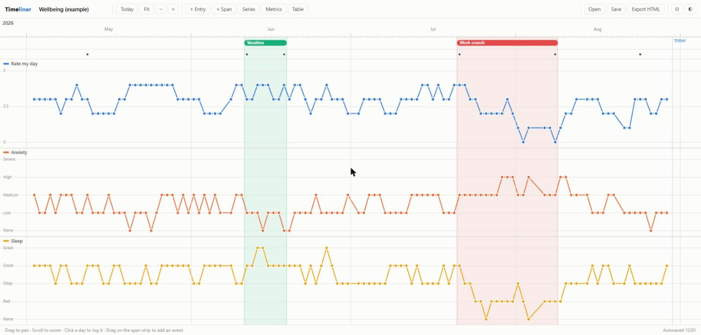
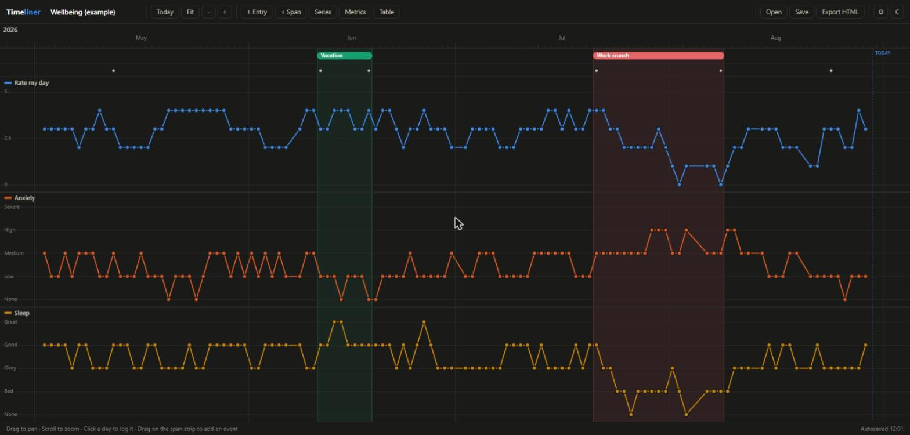
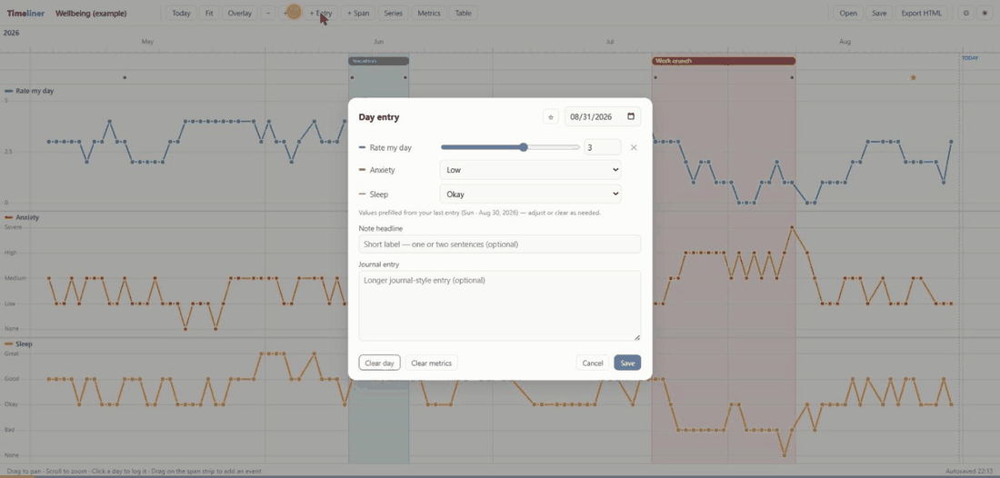
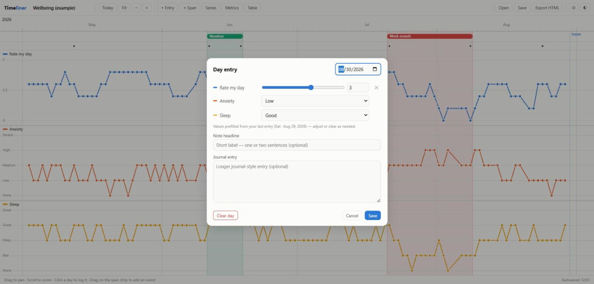
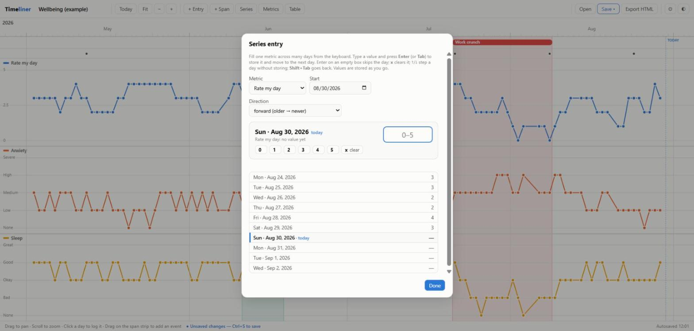
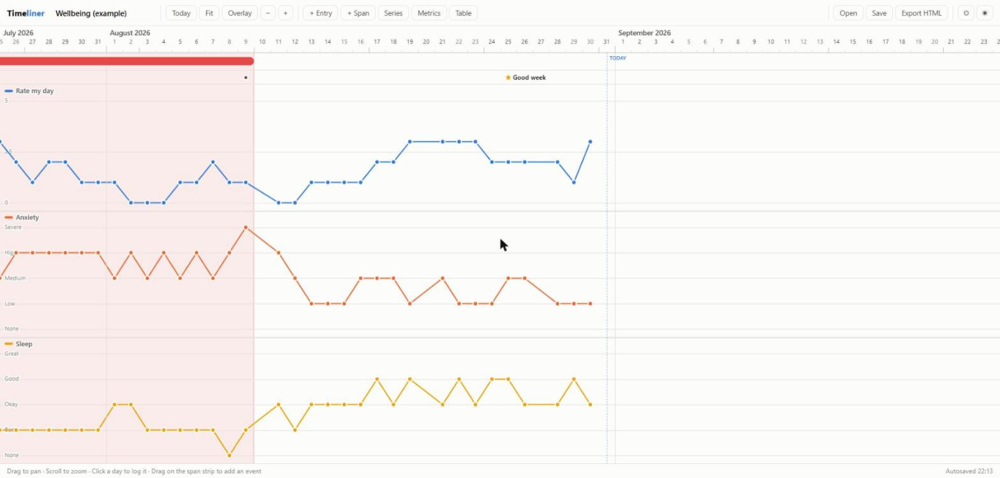
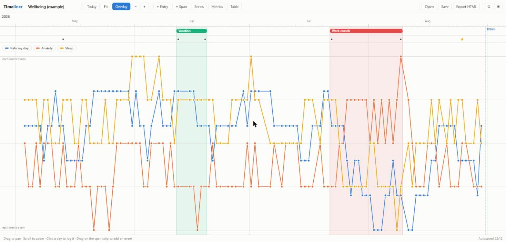
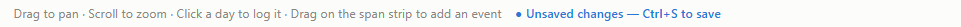
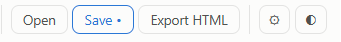

# Timeliner

A single-file app for building visual timelines of your life: track any custom
metrics day by day, annotate days with short headlines or long journal entries,
and mark multi-day events — all on one scrollable, zoomable chart.

**The whole app is one file: [`timeliner.html`](timeliner.html).** Download it
and double-click it to run; no install, no server, no build step, no account.
It works in any modern browser (Chrome, Edge, Firefox, Safari) on any device,
and your data never leaves your machine unless you choose to back it up.



## Features

- **Custom metrics, custom scales.** Each metric gets its own lane with its own
  scale — numeric ranges (0–5, 1–10, whatever) or ordered labels
  (`None, Bad, Okay, Good, Great`). Add, reorder, recolor, and remove metrics
  under **Metrics**.
- **Day entries.** Click any day on the chart (or press **N** for today) to log
  metric values and a note — a short headline, a long journal entry, or both.
  New days start from your last recorded values, so a "same as yesterday" day
  is one click.
- **Series entry.** Backfill one metric across many days from the keyboard:
  type a value, press **Enter**, type the next one… (see the walkthrough).
- **Overlay view.** Toggle **Overlay** (or press **O**) to superimpose every
  metric on one graph, each scaled to its own min–max range. Click the legend
  chips to show or hide individual metrics.
- **Starred days.** Mark a significant day with a ★ — it stands out on the
  note strip and its headline shows earlier, bolder, and longer, pulling the
  reader toward that day's journal entry.
- **Inverted scales.** Flip any metric's axis (*invert axis* in the metric
  editor) for scales where the low number is the good end (1 = best).
- **Gaps, your way.** By default the line bridges up to 3 missed days; a
  Settings toggle makes any missed day break the line instead.
- **Event spans.** Drag on the span strip (below the time axis) to mark
  multi-day events — vacations, medication trials, illnesses. They render as
  colored bars plus a tinted background band. Drag a bar to move it, drag its
  edges to extend it, click it to rename/recolor/delete.
- **Zoom & scroll.** Mouse wheel zooms around the cursor (decades down to
  individual days); drag to pan; trackpad pinch and two-finger scroll work too.
  The axis adapts: year labels → month labels → day numbers with week/month
  tick emphasis.
- **Notes that scale.** Zoomed in, notes show as clickable headlines; zoomed
  out they collapse into dots, then into count bubbles (click a bubble to zoom
  into it).
- **Hover readout.** A crosshair follows the pointer and a tooltip shows every
  metric's value, the note, and any events for that day.
- **Table view** of all entries (click a row to edit that day).
- **Unsaved-changes guard.** Edits are autosaved to the browser immediately,
  and the app tells you when your *file* is out of date — and warns before you
  close the tab.
- **Light/dark theme** (auto-detects, toggle with ◐).



## Walkthrough



*Above: logging today (prefilled values, a headline, a ★), filling a gap with
Series entry, then comparing all metrics in the Overlay view.*

### 1. Start a timeline

Open `timeliner.html`. On the empty-state card choose **Add metrics** to define
what you want to track, or **Load example** to play with generated data first.

For each metric pick a name, a color, and a scale:

| Type | Example | Notes |
|---|---|---|
| Number scale | `0` – `5`, step `1` | any min/max/step, decimals allowed |
| Ordered labels | `None, Low, Medium, High, Severe` | worst → best, comma separated |

### 2. Log a day

Click a day on the chart, or press **N** for today. The **Day entry** dialog
shows a row per metric plus a headline and a journal field.



- A day with no entry yet is **prefilled from your most recent values** (the
  hint under the rows says which entry they came from). Adjust what changed
  and hit **Save** — or just Save if nothing did.
- A metric with no value shows a dimmed slider parked at the minimum and a
  `—` in the number box. The **✕** button returns a metric to that state, so
  you can record "no data" for a day.
- Headline and journal are never prefilled.
- **Clear metrics** unsets every metric row at once — for days where you only
  want to write, save a journal-only entry with no values.
- The **☆** button in the header stars the day (next section).
- **Clear day** removes the whole entry.

### 3. Enter a series of values (keyboard-first)

When you have a stretch of days to backfill for one metric, open **Series**
(toolbar) or press **Q**.



1. Pick the **metric**, a **start** date (defaults to the day after that
   metric's latest value) and a **direction**.
2. Type a value and press **Enter** or **Tab**. The value is stored, the chart
   behind the dialog updates, and the cursor moves to the next day.
3. Keep going. The list underneath shows the surrounding days and their
   current values, with today marked.

| Key | In the Series dialog |
|---|---|
| `Enter` / `Tab` | store the value and move to the next day |
| `Enter` on an empty box | skip the day (leaves any existing value alone) |
| `x` + `Enter` | clear the day's value |
| `Shift+Tab` | go back one day (undo the last advance) |
| `↑` / `↓` | move to the previous / next calendar day without storing |
| `1`…`n` | for label metrics: pick the *n*‑th label (the legend shows the numbers) |
| a label, or its unique prefix | `sev` → Severe; ambiguous prefixes are rejected |
| `Esc` | close — everything typed so far is already stored |

The quick-key chips are clickable too, for mouse users.

### 4. Star the days that matter

Some days deserve to be found again. Star a day with the **☆** button in the
Day entry header, or with **☆ Star** when reading a note. On the note strip a
starred day draws an amber ★ instead of a dot, and its headline appears at
lower zoom, bolder and longer than ordinary notes — so a reader scanning the
timeline is drawn to open exactly those entries. A day can be starred on its
own, even with no values and no note.



### 5. Compare metrics with Overlay

Press **O** (or click **Overlay**) to superimpose all metrics on one graph.
Each metric is scaled to its own min–max range so shapes are comparable even
when the scales aren't. Click a legend chip to hide or show that metric — and
if a metric reads "backwards" (1 = best), turn on *invert axis* in the metric
editor so all the lines agree about which way is up.



### 6. Mark events

Drag across the strip just below the time axis to create a span; give it a
label and a color. Drag a bar to move it, drag its ends to resize it, click it
to edit or delete.

### 7. Save your file

Autosave to the browser is always on, so closing the tab loses nothing. But the
browser's storage isn't a backup: press **Ctrl+S** (or click **Save**) to
write a `*.timeliner.json` file you own. After the first save, Ctrl+S writes
to the same file silently (Chrome/Edge); **Ctrl+Shift+S** does "save as".

While your file is out of date you'll see:




…plus a `•` in the tab title. Panning and zooming don't count as changes. If
you try to close or reload the tab with unsaved changes, the browser asks
first; opening another file asks too. The indicator clears after a successful
Save (or Drive backup).

## Saving and loading

- **Autosave:** every change is saved to the browser's local storage
  immediately.
- **Save / Open (Ctrl+S / Ctrl+O):** stores the timeline as pretty-printed,
  human-readable JSON (`*.timeliner.json`). Dates are plain `YYYY-MM-DD` keys
  and label values are stored as their text, so the file is easy to read, diff,
  and edit by hand.
- **Export HTML:** writes a *single self-contained HTML file* with the app and
  your data embedded — an interactive snapshot you can open on any device,
  email to someone, or keep as a backup. It's fully functional (zoom, edit,
  save), not just a picture.

### File format sketch

```json
{
  "app": "timeliner",
  "title": "Wellbeing",
  "metrics": [
    { "id": "rate",  "name": "Rate my day", "type": "scale",  "min": 0, "max": 5, "step": 1, "color": "slot:1" },
    { "id": "sleep", "name": "Sleep",       "type": "levels", "levels": ["None", "Bad", "Okay", "Good", "Great"], "color": "slot:4" }
  ],
  "entries": {
    "2026-07-30": {
      "v": { "rate": 4, "sleep": "Good" },
      "note": { "title": "Good week", "body": "Longer journal text…" }
    }
  },
  "spans": [
    { "start": "2026-07-01", "end": "2026-07-09", "label": "Vacation", "color": "slot:3" }
  ]
}
```

`"color"` is either `slot:1`–`slot:8` (the built-in palette, which adapts to
light/dark mode) or any `#rrggbb` hex.

## Google Drive backup (optional)

Settings (⚙) has one-click **Back up now** / **Restore latest** to a
`Timeliner` folder in your Google Drive. Two requirements:

1. **Your own OAuth Client ID** (free, ~5 minutes): at
   [console.cloud.google.com](https://console.cloud.google.com) create a
   project → *APIs & Services → Enable APIs* → enable **Google Drive API** →
   *Credentials → Create credentials → OAuth client ID → Web application* →
   add your origin (e.g. `http://localhost:3000`) to *Authorized JavaScript
   origins*. Paste the client ID into Settings.
2. **Serve the app over http(s)** — Google sign-in doesn't work from `file://`.
   From this folder run either:
   ```
   npx serve
   ```
   or
   ```
   python -m http.server 3000
   ```
   and open `http://localhost:3000/timeliner.html`.

The app only requests the `drive.file` scope, so it can only see files it
created itself.

**Zero-setup alternative:** just Save / Export into your local Google Drive
(or Dropbox/OneDrive) sync folder — same durability, no OAuth.

## Keyboard shortcuts

| Key | Action |
|---|---|
| `←` / `→` | pan (Shift = faster) |
| `+` / `-` | zoom |
| `T` / `Home` | center on today |
| `F` | fit all data |
| `N` | log today |
| `Q` | series entry (one metric, many days) |
| `O` | toggle overlay view |
| `Ctrl+S` / `Ctrl+Shift+S` | save / save as (works anywhere, even inside dialogs) |
| `Ctrl+O` | open file |

## Development

There is no build step: edit `timeliner.html` and reload. Everything — CSS,
JavaScript, dialogs — lives in that one file on purpose, because **Export
HTML** re-serializes the live page with the data embedded, so the exported
file must be self-contained.

For local testing, serve the folder (`python -m http.server 8741`) rather than
opening it from `file://` when you want to exercise the Drive backup.

Your own `*.timeliner.json` files are git-ignored so personal data can't be
committed by accident.
